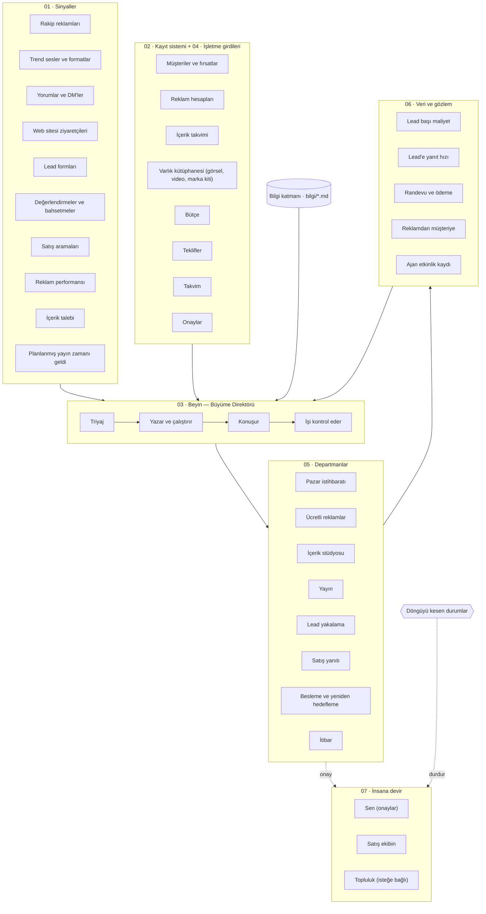

# Yapay Zekâ Sosyal Medya Ekibi

> Bu dosya `npm run katalog` ile `src/ekip.ts` ve `src/beyin.ts` dosyalarından üretilir; elle düzenlemeyin.

**Claude yazar, kurallar karar verir, ElevenLabs konuşur, sen yalnızca onaylarsın.**

## Akış

## 01 · Sinyaller

| Sinyal | Kaynaklar | Yönlendiği departman |
|---|---|---|
| Rakip reklamları (`rakip-reklamlari`) | Meta Reklam Kütüphanesi, TikTok Creative Center | Pazar istihbaratı |
| Trend sesler ve formatlar (`trendler`) | TikTok, Instagram Reels, Google Trends | Pazar istihbaratı |
| Yorumlar ve DM'ler (`yorum-ve-dm`) | Instagram, Facebook, TikTok, LinkedIn | Satış yanıtı |
| Web sitesi ziyaretçileri (`web-ziyaretcisi`) | Meta Pixel, Google Analytics | Besleme ve yeniden hedefleme |
| Lead formları (`lead-formu`) | Meta Lead Ads, Web formu, Typeform | Lead yakalama |
| Değerlendirmeler ve bahsetmeler (`degerlendirme`) | Google İşletme Profili, Trustpilot, Etiketlemeler | İtibar |
| Satış aramaları (`satis-aramasi`) | Telefon (Twilio), Zoom, Fireflies | Satış yanıtı |
| Reklam performansı (`reklam-performansi`) | Meta Ads, TikTok Ads, Google Ads | Ücretli reklamlar |
| İçerik talebi (`icerik-talebi`) | İçerik takvimi, Müşteri portalı | İçerik stüdyosu |
| Planlanmış yayın zamanı geldi (`yayin-zamani`) | İçerik takvimi | Yayın |

## 02 · Kayıt sistemi

- **Müşteriler ve fırsatlar** — GoHighLevel / HubSpot
- **Reklam hesapları** — Meta Business, TikTok Ads, Google Ads
- **İçerik takvimi** — Notion, Metricool
- **Varlık kütüphanesi (görsel, video, marka kiti)** — Google Drive, Canva

## 04 · İşletme girdileri

- **Bütçe** — Aylık reklam bütçesi ve kanal dağılımı
- **Teklifler** — Satılan paketler, fiyatlar, kampanyalar
- **Takvim** — Lansmanlar, özel günler, satış görüşmesi müsaitliği
- **Onaylar** — Neyin kimden onay alacağı (bilgi/onay-kurallari.md)

## 03 · Beyin

| Rol | Görev | Araç |
|---|---|---|
| Triyaj | Gelen her sinyali doğru departmana yönlendirir, döngüyü kesen durumları yakalar | Kurallar (src/beyin.ts) + Claude |
| Yazar ve çalıştırır | Metin, senaryo, yanıt ve reklam varyasyonlarını yazar; iş akışlarını çalıştırır | Claude API + n8n / Make |
| Konuşur | Gelen aramaları yanıtlar, sesli takip ve seslendirme üretir | ElevenLabs |
| İşi kontrol eder | Her çıktıyı marka sesi, yasaklar ve kalite listesine göre denetler; geçemeyeni geri gönderir | Claude + bilgi/kalite-kontrol.md |

## 05 · Departmanlar

### Pazar istihbaratı

> Rakiplerin ve nişin ne yaptığını, neyin tuttuğunu izler; fikir ve açı üretir

- Rakip reklam ve içerik takibi
- Trend ses/format tespiti
- Haftalık 'ne tutuyor' raporu
- Satış görüşmesi öncesi profil analizi

- **Araçlar:** Meta Reklam Kütüphanesi, Apify, Perplexity, Claude
- **Okuduğu bilgi:** [ideal-musteri.md](bilgi/ideal-musteri.md), [rakipler.md](bilgi/rakipler.md)
- **İnsan onayı:** Hayır — kurallar içinde kendi çalışır
- **Çalıştırdığı sistemler:** [#15 Görüşme öncesi araştırma özeti](KATALOG.md#15-gorusme-oncesi-arastirma), [#3 Müşteri yol haritaları](KATALOG.md#3-musteri-yol-haritasi)

### Ücretli reklamlar

> Reklam metni ve varyasyonlarını üretir, bütçe içinde kampanyaları yönetir

- Reklam metni ve kreatif varyasyonları
- A/B testi kurulumu
- Kötü reklamı durdurma, iyiyi ölçekleme
- Günlük bütçe kontrolü

- **Araçlar:** Meta Ads, TikTok Ads, Google Ads, Claude
- **Okuduğu bilgi:** [marka-sesi.md](bilgi/marka-sesi.md), [teklifler.md](bilgi/teklifler.md), [yasaklar.md](bilgi/yasaklar.md)
- **İnsan onayı:** Evet — yayından/gönderimden önce
- **Çalıştırdığı sistemler:** [#14 Satış panosu](KATALOG.md#14-satis-panosu), [#2 Müşteri sonuç takibi](KATALOG.md#2-sonuc-takibi)

### İçerik stüdyosu

> Strateji ve içerik sütunlarından hook, senaryo, carousel ve görsel üretir

- Hook ve senaryo yazımı
- Carousel ve kapak tasarımı
- Seslendirme (ElevenLabs)
- Kısa video kurgusu

- **Araçlar:** Claude, Canva, CapCut, ElevenLabs, Notion
- **Okuduğu bilgi:** [marka-sesi.md](bilgi/marka-sesi.md), [icerik-sutunlari.md](bilgi/icerik-sutunlari.md), [hook-kutuphanesi.md](bilgi/hook-kutuphanesi.md), [yasaklar.md](bilgi/yasaklar.md)
- **İnsan onayı:** Evet — yayından/gönderimden önce
- **Çalıştırdığı sistemler:** [#6 Proje (içerik üretim) panosu](KATALOG.md#6-proje-panosu), [#7 SOP kütüphanesi](KATALOG.md#7-sop-kutuphanesi), [#3 Müşteri yol haritaları](KATALOG.md#3-musteri-yol-haritasi)

### Yayın

> Onaylı içerikleri doğru platformda doğru saatte yayınlar

- Platforma göre biçimlendirme
- Zamanlama
- Açıklama, etiket ve CTA
- Yayın sonrası ilk saat takibi

- **Araçlar:** Metricool / Later, Instagram, TikTok, LinkedIn, YouTube
- **Okuduğu bilgi:** [marka-sesi.md](bilgi/marka-sesi.md)
- **İnsan onayı:** Hayır — kurallar içinde kendi çalışır
- **Çalıştırdığı sistemler:** [#6 Proje (içerik üretim) panosu](KATALOG.md#6-proje-panosu), [#2 Müşteri sonuç takibi](KATALOG.md#2-sonuc-takibi)

### Lead yakalama

> Her kaynaktan gelen lead'i CRM'e kaydeder, zenginleştirir ve niteler

- Form/DM/reklam lead'ini CRM'e yazma
- Kaynak etiketleme (hangi içerik getirdi)
- Lead zenginleştirme
- Niteleme puanı

- **Araçlar:** Meta Lead Ads, ManyChat, Zapier, GoHighLevel
- **Okuduğu bilgi:** [ideal-musteri.md](bilgi/ideal-musteri.md)
- **İnsan onayı:** Hayır — kurallar içinde kendi çalışır
- **Çalıştırdığı sistemler:** [#13 Satış CRM'i](KATALOG.md#13-satis-crm), [#19 Yapay zekâ randevu ayarlayıcı](KATALOG.md#19-yz-randevu-ayarlayici)

### Satış yanıtı

> DM, yorum ve aramalara dakikalar içinde yanıt verir, randevu alır

- 5 dakikada DM/yorum yanıtı
- Gelen aramayı sesli karşılama
- Niteleme soruları
- Takvimden randevu
- Gelmeyene yeniden randevu

- **Araçlar:** ManyChat, ElevenLabs, Twilio, Cal.com, Claude
- **Okuduğu bilgi:** [marka-sesi.md](bilgi/marka-sesi.md), [teklifler.md](bilgi/teklifler.md), [itiraz-yanitlari.md](bilgi/itiraz-yanitlari.md), [sss.md](bilgi/sss.md)
- **İnsan onayı:** Hayır — kurallar içinde kendi çalışır
- **Çalıştırdığı sistemler:** [#19 Yapay zekâ randevu ayarlayıcı](KATALOG.md#19-yz-randevu-ayarlayici), [#18 Gelmeyene yeniden randevu akışı](KATALOG.md#18-gelmeyene-yeniden-randevu), [#15 Görüşme öncesi araştırma özeti](KATALOG.md#15-gorusme-oncesi-arastirma)

### Besleme ve yeniden hedefleme

> Henüz almaya hazır olmayanları e-posta, DM ve reklamla sıcak tutar

- E-posta/DM besleme dizileri
- Site ziyaretçisine yeniden hedefleme
- Teklif sonrası takip
- Kaybedilen fırsatı yeniden canlandırma

- **Araçlar:** Meta Ads, Mailchimp / Klaviyo, GoHighLevel, Claude
- **Okuduğu bilgi:** [teklifler.md](bilgi/teklifler.md), [itiraz-yanitlari.md](bilgi/itiraz-yanitlari.md)
- **İnsan onayı:** Hayır — kurallar içinde kendi çalışır
- **Çalıştırdığı sistemler:** [#20 Yapay zekâ takip mesajları](KATALOG.md#20-yz-takip-mesajlari)

### İtibar

> Değerlendirme ve bahsetmeleri izler, yanıtlar, mutlu müşteriden yorum ister

- Değerlendirmelere yanıt
- Olumsuzu erken yakalama
- Mutlu müşteriden yorum ve video isteme
- Bahsetme takibi

- **Araçlar:** Google İşletme Profili, Trustpilot, Claude
- **Okuduğu bilgi:** [marka-sesi.md](bilgi/marka-sesi.md), [yasaklar.md](bilgi/yasaklar.md)
- **İnsan onayı:** Evet — yayından/gönderimden önce
- **Çalıştırdığı sistemler:** [#10 Aylık NPS anketi](KATALOG.md#10-aylik-nps-anketi), [#8 Müşteri sağlık skoru](KATALOG.md#8-musteri-saglik-skoru)

## 06 · Veri ve gözlem

| Metrik | Cevapladığı soru | Hedef |
|---|---|---|
| Lead başı maliyet | Bir lead kaç liraya geliyor, kanala göre? | Hedef CPL'nin altında |
| Lead'e yanıt hızı | Lead geldikten kaç dakika sonra ilk yanıt gitti? | ≤ 5 dk |
| Randevu ve ödeme | Kaç randevu alındı, kaçı ödemeye döndü? | Görüşme → kapanış ≥ %25 |
| Reklamdan müşteriye | Hangi reklam/içerik gerçekten ödeyen müşteri getirdi? | Her müşterinin kaynağı bilinir |
| Ajan etkinlik kaydı | Hangi ajan ne yaptı, ne kadar sürdü, ne kadar tuttu, nerede hata yaptı? | Tüm eylemler kayıtlı |

## 07 · İnsana devir

- **Sen (onaylar)** (Slack / Telegram) — Reklam, içerik ve itibar yanıtlarını Slack/Telegram'dan tek tıkla onaylarsın
- **Satış ekibin** (CRM + takvim) — Nitelikli randevular ve insan isteyen arayanlar devredilir
- **Topluluk (isteğe bağlı)** (Skool / Discord) — Ücretli topluluk/eğitim üyelerinin yönetimi

## Döngüyü kesen durumlar

Triyaj bunlardan birini görürse otomatik akış durur ve iş insana geçer (`src/beyin.ts`).

| Durum | Ne yapılır | Kime |
|---|---|---|
| Bütçe limitine ulaşıldı | Reklamları duraklat, bütçe artışı için onay iste | Sen |
| Reklam reddedildi | Red gerekçesini ve düzeltilmiş metni onaya sun | Sen |
| Lead başı maliyet sıçradı | Ölçeklemeyi durdur, olası nedenleri ve önerilen değişikliği raporla | Sen |
| Rakip lansman yaptı | Rakibin teklifini ve açısını özetle, karşı hamle önerisini onaya sun | Sen |
| Öfkeli yorumlar yayılıyor | Otomatik yanıtları durdur, tek bir resmi yanıt taslağını onaya sun | Sen |
| Tek / iki yıldızlı değerlendirme | Kamuya açık yanıt taslağını onaya sun, müşteriyi özelden ara | Sen |
| Arayan/yazan bir insan istiyor | Konuşmayı özetiyle birlikte satış ekibine devret | Satış ekibi |
| Büyük anlaşma masada | Yapay zekâ yanıtını durdur, araştırma özetiyle satış ekibine devret | Satış ekibi |
