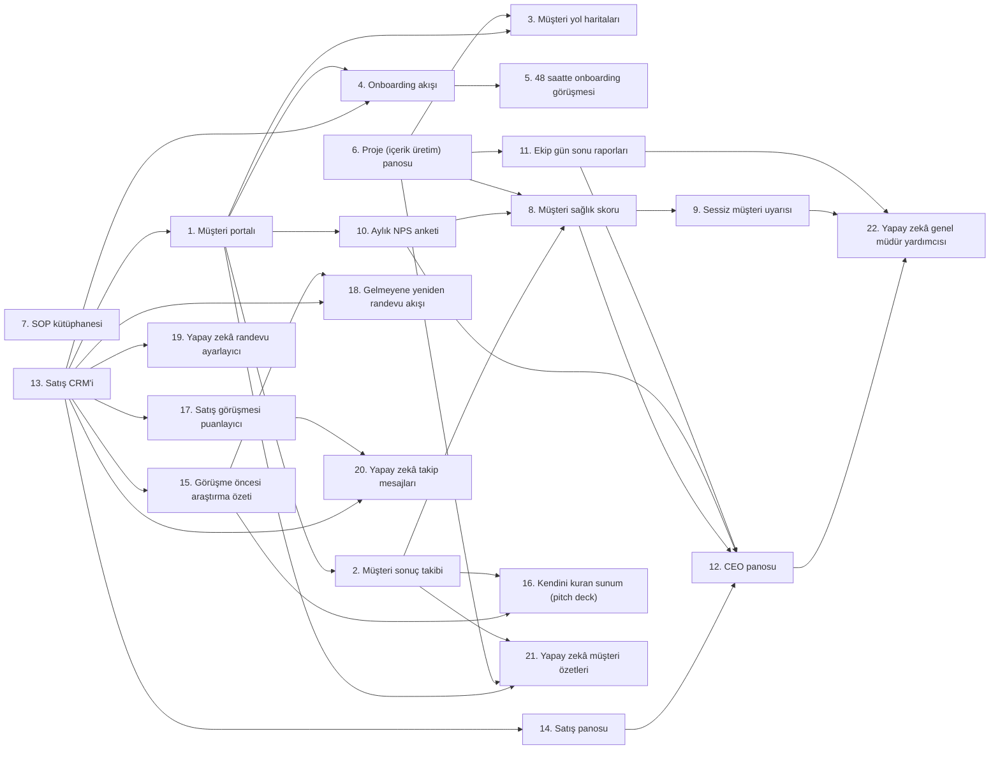

# Sosyal Medya Ajansı — 22 Sistem Kataloğu

> Bu dosya `npm run katalog` ile `src/sistemler.ts` dosyasından üretilir; elle düzenlemeyin.

## Özet

| # | Sistem | Kategori | Sahibi | Otomasyon |
|---|---|---|---|---|
| 1 | [Müşteri portalı](#1-musteri-portali) | Müşteri Deneyimi | Hesap Yöneticisi | Tam otomatik |
| 2 | [Müşteri sonuç takibi](#2-sonuc-takibi) | Müşteri Deneyimi | Hesap Yöneticisi | Tam otomatik |
| 3 | [Müşteri yol haritaları](#3-musteri-yol-haritasi) | Müşteri Deneyimi | İçerik Stratejisti | Yarı otomatik |
| 4 | [Onboarding akışı](#4-onboarding-akisi) | Onboarding | Hesap Yöneticisi | Tam otomatik |
| 5 | [48 saatte onboarding görüşmesi](#5-onboarding-gorusmesi-48s) | Onboarding | İçerik Stratejisti | Yarı otomatik |
| 6 | [Proje (içerik üretim) panosu](#6-proje-panosu) | Operasyon | Operasyon Müdürü | Manuel |
| 7 | [SOP kütüphanesi](#7-sop-kutuphanesi) | Operasyon | Operasyon Müdürü | Manuel |
| 8 | [Müşteri sağlık skoru](#8-musteri-saglik-skoru) | Müşteri Tutundurma | Hesap Yöneticisi | Tam otomatik |
| 9 | [Sessiz müşteri uyarısı](#9-sessiz-musteri-uyarisi) | Müşteri Tutundurma | Hesap Yöneticisi | Tam otomatik |
| 10 | [Aylık NPS anketi](#10-aylik-nps-anketi) | Müşteri Tutundurma | Hesap Yöneticisi | Tam otomatik |
| 11 | [Ekip gün sonu raporları](#11-gun-sonu-raporlari) | Operasyon | Operasyon Müdürü | Yarı otomatik |
| 12 | [CEO panosu](#12-ceo-panosu) | Yönetim | Kurucu / CEO | Tam otomatik |
| 13 | [Satış CRM'i](#13-satis-crm) | Satış | Satış Müdürü | Yarı otomatik |
| 14 | [Satış panosu](#14-satis-panosu) | Satış | Satış Müdürü | Tam otomatik |
| 15 | [Görüşme öncesi araştırma özeti](#15-gorusme-oncesi-arastirma) | Satış | Satış Müdürü | Tam otomatik |
| 16 | [Kendini kuran sunum (pitch deck)](#16-kendini-kuran-sunum) | Satış | Satış Müdürü | Yarı otomatik |
| 17 | [Satış görüşmesi puanlayıcı](#17-satis-gorusmesi-puanlayici) | Satış | Satış Müdürü | Tam otomatik |
| 18 | [Gelmeyene yeniden randevu akışı](#18-gelmeyene-yeniden-randevu) | Satış | Satış Müdürü | Tam otomatik |
| 19 | [Yapay zekâ randevu ayarlayıcı](#19-yz-randevu-ayarlayici) | Yapay Zekâ Çalışanları | Satış Müdürü | Tam otomatik |
| 20 | [Yapay zekâ takip mesajları](#20-yz-takip-mesajlari) | Yapay Zekâ Çalışanları | Satış Müdürü | Yarı otomatik |
| 21 | [Yapay zekâ müşteri özetleri](#21-yz-musteri-ozetleri) | Yapay Zekâ Çalışanları | Hesap Yöneticisi | Yarı otomatik |
| 22 | [Yapay zekâ genel müdür yardımcısı](#22-yz-genel-mudur-yardimcisi) | Yapay Zekâ Çalışanları | Kurucu / CEO | Tam otomatik |

## Kurulum sırası

Her dalga, önceki dalgalar kurulduktan sonra paralel kurulabilir.

1. **Dalga 1:** #6 Proje (içerik üretim) panosu, #7 SOP kütüphanesi, #13 Satış CRM'i
2. **Dalga 2:** #1 Müşteri portalı, #11 Ekip gün sonu raporları, #14 Satış panosu, #15 Görüşme öncesi araştırma özeti, #17 Satış görüşmesi puanlayıcı, #19 Yapay zekâ randevu ayarlayıcı
3. **Dalga 3:** #2 Müşteri sonuç takibi, #3 Müşteri yol haritaları, #4 Onboarding akışı, #10 Aylık NPS anketi, #18 Gelmeyene yeniden randevu akışı, #20 Yapay zekâ takip mesajları
4. **Dalga 4:** #5 48 saatte onboarding görüşmesi, #8 Müşteri sağlık skoru, #16 Kendini kuran sunum (pitch deck), #21 Yapay zekâ müşteri özetleri
5. **Dalga 5:** #9 Sessiz müşteri uyarısı, #12 CEO panosu
6. **Dalga 6:** #22 Yapay zekâ genel müdür yardımcısı

## Bağımlılık haritası

## Müşteri Deneyimi

### 1. Müşteri portalı _(Client portal)_

> Müşterinin içerik takvimini, onay bekleyen gönderileri, raporları ve faturaları tek yerden görmesi; WhatsApp'ta kaybolan onayları bitirmek.

| | |
|---|---|
| **Kategori** | Müşteri Deneyimi |
| **Sahibi** | Hesap Yöneticisi |
| **Otomasyon** | Tam otomatik |
| **Tetikleyici** | Olay: Sözleşme imzalandı |
| **Girdiler** | Müşteri kaydı (CRM) · İçerik takvimi · Aylık raporlar · Faturalar |
| **Çıktılar** | Müşteriye özel giriş · Onay bekleyen içerikler ekranı · Canlı büyüme grafikleri · Mesaj kanalı |
| **Araçlar** | Notion / SuiteDash · Planable (içerik onayı) |
| **Dayandığı sistemler** | [#13 Satış CRM'i](#13-satis-crm) |
| **Beslediği sistemler** | [#2 Müşteri sonuç takibi](#2-sonuc-takibi) · [#3 Müşteri yol haritaları](#3-musteri-yol-haritasi) · [#4 Onboarding akışı](#4-onboarding-akisi) · [#10 Aylık NPS anketi](#10-aylik-nps-anketi) · [#21 Yapay zekâ müşteri özetleri](#21-yz-musteri-ozetleri) |

**Adımlar**

1. Sözleşme imzalanınca müşteri için portal alanı aç
2. İçerik takvimi, onay kuyruğu, sonuç takibi ve marka kitini portala bağla
3. Giriş bilgilerini hoş geldin e-postasıyla gönder
4. Tüm içerik onaylarını yalnızca portaldan al (tek tıkla Onayla / Revize iste)

**Başarı ölçütleri**

- İçerik onay süresi: **≤ 24 saat**
- WhatsApp'tan gelen 'durum ne?' sorusu: **Haftada ≤ 2**

### 2. Müşteri sonuç takibi _(Client results tracker)_

> Müşterinin hesabının başlangıca ve hedefe göre nerede olduğunu sayılarla göstermek: takipçi, erişim, etkileşim ve en önemlisi içerikten gelen satış/lead.

| | |
|---|---|
| **Kategori** | Müşteri Deneyimi |
| **Sahibi** | Hesap Yöneticisi |
| **Otomasyon** | Tam otomatik |
| **Tetikleyici** | Zamanlama: Her pazartesi 09:00 |
| **Girdiler** | Başlangıç (gün 0) istatistikleri · Hedefler · Instagram / TikTok / LinkedIn / YouTube API verileri · Bio linki ve DM'den gelen lead'ler |
| **Çıktılar** | Gün 0 → bugün → hedef grafiği · En iyi 5 içerik · Kazanım listesi (vaka çalışması malzemesi) |
| **Araçlar** | Metricool / Iconosquare · Instagram Graph API · Looker Studio |
| **Dayandığı sistemler** | [#1 Müşteri portalı](#1-musteri-portali) |
| **Beslediği sistemler** | [#8 Müşteri sağlık skoru](#8-musteri-saglik-skoru) · [#16 Kendini kuran sunum (pitch deck)](#16-kendini-kuran-sunum) · [#21 Yapay zekâ müşteri özetleri](#21-yz-musteri-ozetleri) |

**Adımlar**

1. Onboarding'de tüm hesapların gün 0 ekran görüntülerini ve istatistiklerini kaydet
2. Haftalık olarak takipçi, erişim, izlenme, etkileşim oranı, profil ziyareti, link tıklaması ve lead sayısını çek
3. Viral olan içerikleri (ortalama erişimin 3 katı) otomatik işaretle
4. Hedefin gerisinde kalanları sağlık skoruna, büyük kazanımları #wins kanalına aktar

**Başarı ölçütleri**

- 90 günde hedefine ulaşan müşteri oranı: **≥ %80**
- Ortalama aylık erişim artışı: **≥ %30**

### 3. Müşteri yol haritaları _(Client roadmaps)_

> Her müşteriye 90 günlük kişisel marka / içerik stratejisi vermek: içerik sütunları, platformlar, paylaşım sıklığı ve aylık kilometre taşları.

| | |
|---|---|
| **Kategori** | Müşteri Deneyimi |
| **Sahibi** | İçerik Stratejisti |
| **Otomasyon** | Yarı otomatik |
| **Tetikleyici** | Olay: Onboarding görüşmesi tamamlandı |
| **Girdiler** | Onboarding formu · Marka sesi ve hedef kitle · Rakip/benzer hesap analizi · Hizmet paketi |
| **Çıktılar** | 90 günlük strateji: 3–5 içerik sütunu, format karışımı, sıklık · Ay 1 / 2 / 3 kilometre taşları · İlk ayın içerik takvimi |
| **Araçlar** | Notion · Claude API (rakip analizi) |
| **Dayandığı sistemler** | [#1 Müşteri portalı](#1-musteri-portali) · [#6 Proje (içerik üretim) panosu](#6-proje-panosu) |
| **Beslediği sistemler** | — |

**Adımlar**

1. Müşterinin ve 5 benzer hesabın en iyi içeriklerini analiz et
2. İçerik sütunlarını (ör. otorite, hikâye, eğitim, sosyal kanıt, satış) belirle
3. Ay 1: temel ve ses bulma · Ay 2: büyüme ve test · Ay 3: dönüşüm ve teklif
4. Müşteriyle onayla, portala yayınla, ilk ayı proje panosuna aktar

**Başarı ölçütleri**

- Onboarding'den stratejiye süre: **≤ 3 gün**
- Zamanında tamamlanan kilometre taşı: **≥ %85**

## Onboarding

### 4. Onboarding akışı _(Onboarding flow)_

> Ödemeden ilk içerik yayınına kadar her müşterinin aynı, hatasız deneyimi yaşaması.

| | |
|---|---|
| **Kategori** | Onboarding |
| **Sahibi** | Hesap Yöneticisi |
| **Otomasyon** | Tam otomatik |
| **Tetikleyici** | Olay: İlk ödeme alındı |
| **Girdiler** | Sözleşme · Ödeme kaydı · Hizmet paketi |
| **Çıktılar** | Hoş geldin e-postası + video · Marka formu · Hesap erişimleri · Ekip ataması |
| **Araçlar** | Zapier / Make · Tally / Typeform · Stripe / iyzico · Google Drive |
| **Dayandığı sistemler** | [#13 Satış CRM'i](#13-satis-crm) · [#1 Müşteri portalı](#1-musteri-portali) |
| **Beslediği sistemler** | [#5 48 saatte onboarding görüşmesi](#5-onboarding-gorusmesi-48s) |

**Adımlar**

1. Hoş geldin e-postası ve kişisel 'hoş geldin' videosunu gönder
2. Marka formunu iste: hikâye, hedef kitle, ses tonu, yapılmayacaklar, renk/font, logo, ürün/teklif
3. Hesap erişimlerini güvenli şekilde iste (Meta Business yöneticisi, TikTok, LinkedIn, Canva; şifre değil yetki)
4. Ham materyal klasörünü (Drive) aç, sorumlu ekibi (stratejist, editör, tasarımcı) ata, görüşmeyi planlat

**Başarı ölçütleri**

- Ödemeden form ve erişimlerin tamamlanmasına süre: **≤ 24 saat**
- Ödemeden ilk yayına süre: **≤ 7 gün**

### 5. 48 saatte onboarding görüşmesi _(Onboarding call in 48h)_

> Satın alma heyecanı sönmeden ilk 48 saatte marka sesini, hedefleri ve çekim planını netleştirmek.

| | |
|---|---|
| **Kategori** | Onboarding |
| **Sahibi** | İçerik Stratejisti |
| **Otomasyon** | Yarı otomatik |
| **Tetikleyici** | Olay: Marka formu tamamlandı |
| **Girdiler** | Marka formu · Takvim müsaitliği |
| **Çıktılar** | Görüşme kaydı ve dökümü · Onaylı hedefler · Ses tonu notları · İlk çekim günü tarihi |
| **Araçlar** | Cal.com / Calendly · Fireflies / tl;dv |
| **Dayandığı sistemler** | [#4 Onboarding akışı](#4-onboarding-akisi) |
| **Beslediği sistemler** | — |

**Adımlar**

1. Formu dolduran müşteriye 48 saat içindeki boş saatleri sun
2. Görüşmede hikâye madenciliği yap: kökeni, inançları, müşteri sonuçları, sık sorulan sorular (içerik fikri hazinesi)
3. Başarı tanımını sayıyla netleştir (ör. 90 günde 10 bin takipçi, ayda 20 DM lead)
4. İlk çekim/kayıt gününü takvime koy; 48 saat dolmadan planlanmamışsa yöneticiye uyarı

**Başarı ölçütleri**

- 48 saatte yapılan görüşme oranı: **≥ %95**
- Görüşmeden çıkan içerik fikri: **≥ 30**

## Operasyon

### 6. Proje (içerik üretim) panosu _(Project board)_

> Her içeriğin hangi aşamada, kimde olduğunu ve ne zaman yayınlanacağını gösteren tek doğru kaynak.

| | |
|---|---|
| **Kategori** | Operasyon |
| **Sahibi** | Operasyon Müdürü |
| **Otomasyon** | Manuel |
| **Tetikleyici** | Manuel: Ekip (her gün) |
| **Girdiler** | Strateji ve içerik takvimi · Ham çekimler · Müşteri revizyonları |
| **Çıktılar** | Aşamalı içerik kartları · Yayın takvimi · Geciken içerik listesi |
| **Araçlar** | ClickUp / Notion / Trello · Metricool / Later (planlama) |
| **Dayandığı sistemler** | — |
| **Beslediği sistemler** | [#3 Müşteri yol haritaları](#3-musteri-yol-haritasi) · [#8 Müşteri sağlık skoru](#8-musteri-saglik-skoru) · [#11 Ekip gün sonu raporları](#11-gun-sonu-raporlari) · [#21 Yapay zekâ müşteri özetleri](#21-yz-musteri-ozetleri) |

**Adımlar**

1. Sütunlar: Fikir → Senaryo/Hook → Çekim → Kurgu/Tasarım → İç kontrol → Müşteri onayı → Planlandı → Yayında
2. Her kart: müşteri, platform, format (Reels/TikTok/Carousel/Story/LinkedIn), tek sorumlu, yayın tarihi
3. Her müşteri için en az 2 hafta ileri hazır içerik tamponu tut
4. Geciken kartları günlük işaretle, haftalık planlamada panoyu düzenle

**Başarı ölçütleri**

- Zamanında yayınlanan içerik oranı: **≥ %95**
- Müşteri başına hazır içerik tamponu: **≥ 2 hafta**

### 7. SOP kütüphanesi _(SOP library)_

> Reels kurgusundan carousel tasarımına, hook yazımından raporlamaya her işin yazılı ve videolu prosedürü; kalitenin kişiye bağlı olmaması.

| | |
|---|---|
| **Kategori** | Operasyon |
| **Sahibi** | Operasyon Müdürü |
| **Otomasyon** | Manuel |
| **Tetikleyici** | Olay: Bir iş üçüncü kez tekrarlandı |
| **Girdiler** | Ekran kaydı (Loom) · Kontrol listesi · Şablonlar (Canva, CapCut, Premiere) |
| **Çıktılar** | Sürümlü SOP sayfası · Yeni editör/tasarımcı eğitim seti · Kalite kontrol listesi |
| **Araçlar** | Notion · Loom |
| **Dayandığı sistemler** | — |
| **Beslediği sistemler** | — |

**Adımlar**

1. Temel SOP'lar: hook yazımı, Reels kurgusu (altyazı, kesme ritmi, ilk 3 saniye), carousel tasarımı, kapak görseli, paylaşım ve hashtag, topluluk yönetimi (yorum/DM), aylık rapor
2. İşi yapan kişi ekranını kaydederek bir kez yapar, kayıttan kontrol listesi çıkar
3. Her SOP'a sahip ve gözden geçirme tarihi yaz
4. Platform algoritması değiştikçe ve her çeyrekte güncelle

**Başarı ölçütleri**

- SOP'u olan tekrarlı iş oranı: **≥ %80**
- Yeni editörün bağımsız çalışma süresi: **≤ 10 gün**
- İç kontrolde reddedilen içerik: **≤ %10**

### 11. Ekip gün sonu raporları _(Team EOD reports)_

> Toplantı yapmadan editör, tasarımcı ve stratejistlerin bugün ne ürettiğini ve nerede tıkandığını görmek.

| | |
|---|---|
| **Kategori** | Operasyon |
| **Sahibi** | Operasyon Müdürü |
| **Otomasyon** | Yarı otomatik |
| **Tetikleyici** | Zamanlama: Hafta içi her gün 17:30 |
| **Girdiler** | Panoda aşama değiştiren içerikler · Kişisel not |
| **Çıktılar** | #team kanalında rapor · Engel listesi (ör. materyal gelmedi, onay bekleniyor) |
| **Araçlar** | Slack Workflow · Google Forms |
| **Dayandığı sistemler** | [#6 Proje (içerik üretim) panosu](#6-proje-panosu) |
| **Beslediği sistemler** | [#12 CEO panosu](#12-ceo-panosu) · [#22 Yapay zekâ genel müdür yardımcısı](#22-yz-genel-mudur-yardimcisi) |

**Adımlar**

1. 17:30'da 3 soruluk form: Bugün biten içerikler / Yarın / Engel
2. Panoda aşama değiştiren kartları otomatik ekle (üretilen içerik sayısı)
3. Müşteri kaynaklı engelleri sessiz müşteri uyarısına, iç engelleri yöneticiye aktar
4. Raporlar yapay zekâ özetiyle sabah CEO'ya gider

**Başarı ölçütleri**

- Rapor gönderme oranı: **≥ %95**
- Kişi başı günlük tamamlanan içerik: **Editör ≥ 4 · Tasarımcı ≥ 6**

## Müşteri Tutundurma

### 8. Müşteri sağlık skoru _(Client health score)_

> Ayrılma riski olan müşteriyi, sözleşme yenilemeden önce tek bir skorla görmek.

| | |
|---|---|
| **Kategori** | Müşteri Tutundurma |
| **Sahibi** | Hesap Yöneticisi |
| **Otomasyon** | Tam otomatik |
| **Tetikleyici** | Zamanlama: Her gün 07:00 |
| **Girdiler** | Büyüme sonuçları · Son iletişim tarihi · NPS · Onay hızı ve revizyon sayısı · Ödeme durumu |
| **Çıktılar** | 0–100 skor · Yeşil / Sarı / Kırmızı etiket · Risk listesi |
| **Araçlar** | Google Sheets / Supabase · Zapier |
| **Dayandığı sistemler** | [#2 Müşteri sonuç takibi](#2-sonuc-takibi) · [#10 Aylık NPS anketi](#10-aylik-nps-anketi) · [#6 Proje (içerik üretim) panosu](#6-proje-panosu) |
| **Beslediği sistemler** | [#9 Sessiz müşteri uyarısı](#9-sessiz-musteri-uyarisi) · [#12 CEO panosu](#12-ceo-panosu) |

**Adımlar**

1. Ağırlıklar: büyüme sonuçları %35, iletişim %20, NPS %20, onay hızı/revizyon %15, ödeme %10
2. Her gün skoru yeniden hesapla
3. Kırmızıya düşen müşteriyi sorumlusuna görev olarak ata (strateji revizyon görüşmesi)
4. Sözleşme bitimine 30 gün kalan sarı/kırmızı müşterileri öne çıkar; trendi CEO panosuna gönder

**Başarı ölçütleri**

- Yeşil müşteri oranı: **≥ %75**
- Aylık müşteri kaybı (churn): **≤ %5**
- Ortalama müşteri ömrü: **≥ 9 ay**

### 9. Sessiz müşteri uyarısı _(Quiet client alert)_

> Onay vermeyen, çekim materyali göndermeyen ya da mesajlara dönmeyen müşteriyi otomatik yakalamak — sessizlik, kaybın ilk işaretidir.

| | |
|---|---|
| **Kategori** | Müşteri Tutundurma |
| **Sahibi** | Hesap Yöneticisi |
| **Otomasyon** | Tam otomatik |
| **Tetikleyici** | Zamanlama: Her gün 08:00 |
| **Girdiler** | Son mesaj/görüşme tarihi · Bekleyen onaylar · Ham materyal yükleme tarihi · Sağlık skoru |
| **Çıktılar** | Sorumluya uyarı · Hazır yeniden temas mesajı taslağı |
| **Araçlar** | Slack · Gmail API · WhatsApp Business API · Zapier |
| **Dayandığı sistemler** | [#8 Müşteri sağlık skoru](#8-musteri-saglik-skoru) |
| **Beslediği sistemler** | [#22 Yapay zekâ genel müdür yardımcısı](#22-yz-genel-mudur-yardimcisi) |

**Adımlar**

1. 5 gündür yanıt yok, 72 saattir onay bekleyen içerik veya 10 gündür yeni çekim materyali yoksa yakala
2. Sorumluya Slack'ten uyarı ve sıcak bir mesaj taslağı gönder (ör. haftanın en iyi performans gösteren içeriğiyle)
3. 10 günü geçenleri yöneticiye yükselt
4. Durumu sağlık skoruna 'iletişim' bileşeni olarak yansıt

**Başarı ölçütleri**

- Uyarıdan sonra 24 saatte temas: **%100**
- Onay gecikmesi yüzünden kaçan yayın: **0**

### 10. Aylık NPS anketi _(Monthly NPS survey)_

> Memnuniyeti her ay tek soruyla ölçmek; mutlu müşterileri referansa ve video yoruma, mutsuzları kurtarmaya yönlendirmek.

| | |
|---|---|
| **Kategori** | Müşteri Tutundurma |
| **Sahibi** | Hesap Yöneticisi |
| **Otomasyon** | Tam otomatik |
| **Tetikleyici** | Zamanlama: Her ayın 1'i, aylık raporla birlikte |
| **Girdiler** | Aktif müşteri listesi · Aylık rapor |
| **Çıktılar** | NPS puanı · Yorumlar · Referans / video yorum / kurtarma görevleri |
| **Araçlar** | Tally / Typeform |
| **Dayandığı sistemler** | [#1 Müşteri portalı](#1-musteri-portali) |
| **Beslediği sistemler** | [#8 Müşteri sağlık skoru](#8-musteri-saglik-skoru) · [#12 CEO panosu](#12-ceo-panosu) |

**Adımlar**

1. '0–10 arası bizi bir arkadaşınıza tavsiye eder misiniz?' + tek açık uçlu soru gönder
2. 9–10 → video yorum ve referans iste (referans başına komisyon / 1 ay indirim)
3. 0–6 → 24 saat içinde kurtarma görüşmesi aç
4. Sonucu sağlık skoruna ve CEO panosuna aktar

**Başarı ölçütleri**

- NPS: **≥ 50**
- Yanıt oranı: **≥ %60**
- Referanstan gelen yeni müşteri: **Ayda ≥ 2**

## Yönetim

### 12. CEO panosu _(CEO dashboard)_

> Ajansın sağlığını tek ekranda, 5 dakikada görmek: gelir, satış, müşteri sonuçları, ekip kapasitesi.

| | |
|---|---|
| **Kategori** | Yönetim |
| **Sahibi** | Kurucu / CEO |
| **Otomasyon** | Tam otomatik |
| **Tetikleyici** | Zamanlama: Gerçek zamanlı; haftalık özet cuma 16:00 |
| **Girdiler** | Gelir ve nakit · Satış panosu · Sağlık skorları · NPS · Gün sonu raporları · Ekip kapasitesi |
| **Çıktılar** | KPI kartları · Trendler · Haftalık 'cuma rakamları' özeti |
| **Araçlar** | Looker Studio / Databox · Stripe · Muhasebe yazılımı |
| **Dayandığı sistemler** | [#14 Satış panosu](#14-satis-panosu) · [#8 Müşteri sağlık skoru](#8-musteri-saglik-skoru) · [#10 Aylık NPS anketi](#10-aylik-nps-anketi) · [#11 Ekip gün sonu raporları](#11-gun-sonu-raporlari) |
| **Beslediği sistemler** | [#22 Yapay zekâ genel müdür yardımcısı](#22-yz-genel-mudur-yardimcisi) |

**Adımlar**

1. Kuzey yıldızı: aylık tekrarlayan gelir (MRR) — ör. 25 müşteri × 4.000 $
2. Kartlar: MRR, nakit, yeni müşteri, churn, NPS, satış hattı, kâr marjı, ayda üretilen içerik, ekip doluluk oranı
3. Her kart için hedef ve renk eşiği belirle; doluluk %85'i geçince işe alım uyarısı
4. Cuma günü otomatik haftalık özet üret

**Başarı ölçütleri**

- Aylık gelir: **≥ 100.000 $**
- Net kâr marjı: **≥ %30**
- Ekip doluluk oranı: **%70–85**

## Satış

### 13. Satış CRM'i _(Sales CRM)_

> Ajansın kendi içeriklerinden, DM'lerden ve referanslardan gelen her potansiyel müşterinin tek kaydı.

| | |
|---|---|
| **Kategori** | Satış |
| **Sahibi** | Satış Müdürü |
| **Otomasyon** | Yarı otomatik |
| **Tetikleyici** | Olay: Yeni potansiyel müşteri (DM anahtar kelimesi, form, referans, reklam) |
| **Girdiler** | Instagram/LinkedIn DM'leri · Web formu · Reklam lead'leri · Referanslar · Takvim randevuları |
| **Çıktılar** | Aşamalı satış hattı · Temas geçmişi · Sonraki adım görevleri |
| **Araçlar** | GoHighLevel / HubSpot / Close · ManyChat |
| **Dayandığı sistemler** | — |
| **Beslediği sistemler** | [#1 Müşteri portalı](#1-musteri-portali) · [#4 Onboarding akışı](#4-onboarding-akisi) · [#14 Satış panosu](#14-satis-panosu) · [#15 Görüşme öncesi araştırma özeti](#15-gorusme-oncesi-arastirma) · [#17 Satış görüşmesi puanlayıcı](#17-satis-gorusmesi-puanlayici) · [#18 Gelmeyene yeniden randevu akışı](#18-gelmeyene-yeniden-randevu) · [#19 Yapay zekâ randevu ayarlayıcı](#19-yz-randevu-ayarlayici) · [#20 Yapay zekâ takip mesajları](#20-yz-takip-mesajlari) |

**Adımlar**

1. Aşamalar: Yeni → Nitelikli → Randevu → Görüşüldü → Teklif → Kazanıldı / Kaybedildi
2. Kaynağı kaydet: hangi içerik/DM anahtar kelimesi lead getirdi (ajansın kendi içerik ROI'si)
3. Her fırsatın bir sonraki adımı ve tarihi olur
4. Kazanılan fırsat onboarding akışını tetikler

**Başarı ölçütleri**

- Sonraki adımı olmayan fırsat: **0**
- Lead'e ilk yanıt süresi: **≤ 5 dk**

### 14. Satış panosu _(Sales dashboard)_

> Satış hunisinin her aşamasındaki dönüşümü, lead kaynaklarını ve satıcı performansını görmek.

| | |
|---|---|
| **Kategori** | Satış |
| **Sahibi** | Satış Müdürü |
| **Otomasyon** | Tam otomatik |
| **Tetikleyici** | Zamanlama: Gerçek zamanlı |
| **Girdiler** | CRM aşamaları · Lead kaynakları · Görüşme puanları · Kapanan gelir |
| **Çıktılar** | Huni dönüşüm oranları · Kaynak bazında lead (hangi içerik satış getiriyor) · Satıcı sıralaması · Gelir tahmini |
| **Araçlar** | GoHighLevel / HubSpot raporları · Looker Studio |
| **Dayandığı sistemler** | [#13 Satış CRM'i](#13-satis-crm) |
| **Beslediği sistemler** | [#12 CEO panosu](#12-ceo-panosu) |

**Adımlar**

1. DM/lead → randevu → katılım → kapanış oranlarını göster
2. Kaynak bazında: organik içerik, reklam, referans, soğuk DM
3. Satıcı bazında görüşme sayısı, kapanış oranı, ortalama aylık paket
4. Hattaki fırsatlardan 30 günlük gelir tahmini; özeti CEO panosuna aktar

**Başarı ölçütleri**

- Görüşme → kapanış oranı: **≥ %25**
- Randevuya katılım oranı: **≥ %75**
- Ortalama aylık paket: **≥ 3.000 $**

### 15. Görüşme öncesi araştırma özeti _(Pre-call research brief)_

> Satıcının her görüşmeye potansiyel müşterinin sosyal medya hesaplarını analiz etmiş olarak, 2 dakikalık bir özetle girmesi.

| | |
|---|---|
| **Kategori** | Satış |
| **Sahibi** | Satış Müdürü |
| **Otomasyon** | Tam otomatik |
| **Tetikleyici** | Olay: Satış görüşmesi randevusu alındı |
| **Girdiler** | Randevu formu yanıtları · Instagram / TikTok / LinkedIn profilleri · Web sitesi ve teklifi · CRM geçmişi |
| **Çıktılar** | Tek sayfalık özet: mevcut takipçi/etkileşim, en iyi ve en kötü 3 içerik, bio ve profil hataları, rakip karşılaştırması, kaçırılan fırsatlar, önerilen açılış |
| **Araçlar** | Claude API · Apify (profil verisi) · Clay |
| **Dayandığı sistemler** | [#13 Satış CRM'i](#13-satis-crm) |
| **Beslediği sistemler** | [#16 Kendini kuran sunum (pitch deck)](#16-kendini-kuran-sunum) · [#18 Gelmeyene yeniden randevu akışı](#18-gelmeyene-yeniden-randevu) |

**Adımlar**

1. Randevu alınınca profilleri tara: paylaşım sıklığı, ortalama izlenme, etkileşim oranı, bio/CTA, öne çıkanlar
2. Aynı nişteki 3 başarılı hesapla karşılaştır
3. Form yanıtlarıyla birleştirip ağrı noktalarını ve olası itirazları çıkar
4. Özeti CRM kaydına ve takvim davetine ekle; görüşmeden 1 saat önce satıcıya hatırlat

**Başarı ölçütleri**

- Özeti hazır görüşme oranı: **%100**

### 16. Kendini kuran sunum (pitch deck) _(Self-building pitch deck)_

> Her potansiyel müşteriye, kendi hesabının denetimini ve 90 günlük büyüme planını içeren otomatik sunum.

| | |
|---|---|
| **Kategori** | Satış |
| **Sahibi** | Satış Müdürü |
| **Otomasyon** | Yarı otomatik |
| **Tetikleyici** | Olay: Araştırma özeti hazır |
| **Girdiler** | Araştırma özeti · Sunum şablonu · Benzer nişten vaka çalışmaları · Paket ve fiyat listesi |
| **Çıktılar** | Kişiselleştirilmiş sunum: profil denetimi, fırsatlar, 3 örnek içerik fikri/hook, 90 günlük plan, vaka çalışması, paketler |
| **Araçlar** | Claude API · Gamma / Google Slides / Canva |
| **Dayandığı sistemler** | [#15 Görüşme öncesi araştırma özeti](#15-gorusme-oncesi-arastirma) · [#2 Müşteri sonuç takibi](#2-sonuc-takibi) |
| **Beslediği sistemler** | — |

**Adımlar**

1. Şablonu müşterinin adı, nişi ve profil denetimiyle doldur
2. Ona özel 3 içerik fikri ve hook yaz (değeri satıştan önce göster)
3. Sonuç takibinden aynı nişteki en iyi vaka çalışmasını seç
4. Satıcı onayına gönder; görüşmede ekran paylaşımıyla kullan, sonra teklif olarak ilet

**Başarı ölçütleri**

- Sunum hazırlama süresi: **≤ 5 dk**
- Sunum gösterilen görüşmelerde kapanış: **≥ %30**

### 17. Satış görüşmesi puanlayıcı _(Sales call grader)_

> Her satış görüşmesini aynı ölçütlerle puanlayıp satıcılara somut geri bildirim vermek.

| | |
|---|---|
| **Kategori** | Satış |
| **Sahibi** | Satış Müdürü |
| **Otomasyon** | Tam otomatik |
| **Tetikleyici** | Olay: Görüşme kaydı/dökümü hazır |
| **Girdiler** | Görüşme dökümü · Satış senaryosu · Puanlama ölçütleri |
| **Çıktılar** | 0–100 puan · Güçlü yönler · Geliştirilecek 3 nokta · CRM notu |
| **Araçlar** | Fireflies / tl;dv · Claude API |
| **Dayandığı sistemler** | [#13 Satış CRM'i](#13-satis-crm) |
| **Beslediği sistemler** | [#20 Yapay zekâ takip mesajları](#20-yz-takip-mesajlari) |

**Adımlar**

1. Ölçütler: hedef ve mevcut durum keşfi, 'neden şimdi', bütçe, itiraz yönetimi ('kendim yaparım', 'daha önce ajansla yandım'), kapanış, konuşma oranı
2. Dökümü ölçütlere göre puanla
3. Satıcıya özet ve öneri gönder
4. Haftalık ortalama puanları satış panosuna aktar

**Başarı ölçütleri**

- Ortalama görüşme puanı: **≥ 80**
- Puanlanan görüşme oranı: **%100**

### 18. Gelmeyene yeniden randevu akışı _(No-show rebook flow)_

> Randevuya gelmeyen potansiyel müşteriyi kaybetmeden yeniden takvime almak.

| | |
|---|---|
| **Kategori** | Satış |
| **Sahibi** | Satış Müdürü |
| **Otomasyon** | Tam otomatik |
| **Tetikleyici** | Olay: Görüşme 10 dk geçti, katılım yok |
| **Girdiler** | Takvim etkinliği · CRM kaydı · Araştırma özeti |
| **Çıktılar** | Yeniden randevu bağlantısı · DM/WhatsApp/e-posta dizisi · CRM durum güncellemesi |
| **Araçlar** | Cal.com / Calendly · WhatsApp Business API · ManyChat |
| **Dayandığı sistemler** | [#13 Satış CRM'i](#13-satis-crm) · [#15 Görüşme öncesi araştırma özeti](#15-gorusme-oncesi-arastirma) |
| **Beslediği sistemler** | — |

**Adımlar**

1. 10. dakikada nazik 'sizi bekliyoruz' mesajı + bağlantı
2. 1 saat sonra yeniden randevu bağlantısı + profil denetiminden 1 merak uyandıran bulgu
3. 1, 3 ve 7. günlerde hatırlatma (Instagram DM dahil)
4. Yanıt yoksa 'Kaybedildi: gelmedi' olarak işaretle ve içerik beslemesine al

**Başarı ölçütleri**

- Gelmeyenlerden yeniden randevu oranı: **≥ %40**

## Yapay Zekâ Çalışanları

### 19. Yapay zekâ randevu ayarlayıcı _(AI appointment setter)_

> Ajansın içeriklerine gelen yorum ve DM'lere dakikalar içinde yanıt verip niteliklendirmek ve satış görüşmesine randevu almak.

| | |
|---|---|
| **Kategori** | Yapay Zekâ Çalışanları |
| **Sahibi** | Satış Müdürü |
| **Otomasyon** | Tam otomatik |
| **Tetikleyici** | Olay: Yeni DM, anahtar kelimeli yorum ('STRATEJİ' yaz) veya form |
| **Girdiler** | Lead bilgisi ve profili · Niteleme soruları · Takvim müsaitliği |
| **Çıktılar** | Nitelikli / niteliksiz kararı · Alınmış randevu · Konuşma özeti (CRM'e) |
| **Araçlar** | ManyChat + Claude API · GoHighLevel |
| **Dayandığı sistemler** | [#13 Satış CRM'i](#13-satis-crm) |
| **Beslediği sistemler** | — |

**Adımlar**

1. 5 dakika içinde DM'den doğal, insan gibi yanıt ver
2. Sor: ne iş yapıyorsun, şu anki takipçi/gelir, hedef, aylık bütçe, karar veren kim
3. Nitelikliyse takvimden randevu al; değilse ücretsiz kaynak/eğitime yönlendir ve beslemeye al
4. Emin olmadığında veya fiyat pazarlığında insana devret

**Başarı ölçütleri**

- DM → randevu oranı: **≥ %20**
- İlk yanıt süresi: **≤ 5 dk**

### 20. Yapay zekâ takip mesajları _(AI follow-ups)_

> Teklif sonrası ve sessiz kalan fırsatlara kişisel takip mesajlarını hiç unutmadan göndermek.

| | |
|---|---|
| **Kategori** | Yapay Zekâ Çalışanları |
| **Sahibi** | Satış Müdürü |
| **Otomasyon** | Yarı otomatik |
| **Tetikleyici** | Olay: Satış görüşmesi bitti veya fırsat 3 gündür hareketsiz |
| **Girdiler** | Görüşme dökümü ve puanı · CRM aşaması · Önceki mesajlar · Yeni vaka çalışmaları |
| **Çıktılar** | Kişiselleştirilmiş takip mesajı taslağı · CRM'de sonraki adım |
| **Araçlar** | Claude API · Gmail / Instagram DM · GoHighLevel |
| **Dayandığı sistemler** | [#13 Satış CRM'i](#13-satis-crm) · [#17 Satış görüşmesi puanlayıcı](#17-satis-gorusmesi-puanlayici) |
| **Beslediği sistemler** | — |

**Adımlar**

1. Görüşmede konuşulan hedefe atıfla takip taslağı yaz
2. Her takipte yeni bir değer kat: benzer müşterinin sonucu, onun nişinde viral olan bir içerik, ücretsiz 1 hook
3. Satıcı onayıyla gönder; 3/7/14. günlerde yeni açıyla tekrarla
4. Yanıt gelince diziyi durdur

**Başarı ölçütleri**

- Takipsiz kalan fırsat: **0**
- Takip yanıt oranı: **≥ %35**

### 21. Yapay zekâ müşteri özetleri _(AI client recaps)_

> Her müşteri görüşmesinden sonra ve her hafta yayınlananları, performansı ve sıradakini müşteriye otomatik özetlemek.

| | |
|---|---|
| **Kategori** | Yapay Zekâ Çalışanları |
| **Sahibi** | Hesap Yöneticisi |
| **Otomasyon** | Yarı otomatik |
| **Tetikleyici** | Olay: Müşteri görüşmesi bitti; ayrıca her cuma |
| **Girdiler** | Görüşme dökümü · Proje panosu · Sonuç takibi |
| **Çıktılar** | Görüşme özeti + aksiyonlar · Haftalık rapor: yayınlananlar, en iyi içerik, rakamlar, gelecek haftanın planı, müşteriden beklenenler |
| **Araçlar** | Claude API · Fireflies / tl;dv |
| **Dayandığı sistemler** | [#1 Müşteri portalı](#1-musteri-portali) · [#6 Proje (içerik üretim) panosu](#6-proje-panosu) · [#2 Müşteri sonuç takibi](#2-sonuc-takibi) |
| **Beslediği sistemler** | — |

**Adımlar**

1. Dökümden kararları, yeni içerik fikirlerini ve aksiyonları çıkar
2. Aksiyonları ve fikirleri proje panosuna kart olarak ekle
3. Özeti sorumlu onayıyla müşteriye gönder ve portala yayınla
4. Cuma günü haftanın performansını yorumlu olarak özetle ('bu Reels neden tuttu?')

**Başarı ölçütleri**

- Görüşmeden özete süre: **≤ 1 saat**
- Haftalık raporun açılma oranı: **≥ %80**

### 22. Yapay zekâ genel müdür yardımcısı _(AI chief of staff)_

> Her sabah kurucuya 'bugün sana ihtiyaç olan 3 şey'i söylemek; tüm sistemlerin üstündeki akıl.

| | |
|---|---|
| **Kategori** | Yapay Zekâ Çalışanları |
| **Sahibi** | Kurucu / CEO |
| **Otomasyon** | Tam otomatik |
| **Tetikleyici** | Zamanlama: Her gün 07:00 |
| **Girdiler** | CEO panosu · Sessiz müşteri uyarıları · Gün sonu raporları · Onay bekleyen işler · Takvim |
| **Çıktılar** | #ceo kanalında sabah brifingi (en önemli 3 iş) · Onay bekleyen kararlar listesi |
| **Araçlar** | Claude API · Slack |
| **Dayandığı sistemler** | [#12 CEO panosu](#12-ceo-panosu) · [#9 Sessiz müşteri uyarısı](#9-sessiz-musteri-uyarisi) · [#11 Ekip gün sonu raporları](#11-gun-sonu-raporlari) |
| **Beslediği sistemler** | — |

**Adımlar**

1. Tüm sistemlerden gece biriken sinyalleri topla
2. Etki × aciliyete göre sırala, en önemli 3'ü seç (ör. 'Yeni işe alım teklifini onayla', 'Sessizleşen X markasını ara', 'Cuma rakamlarına bak')
3. Her madde için tek satırlık bağlam ve önerilen aksiyonu yaz
4. 07:02'de #ceo kanalına gönder

**Başarı ölçütleri**

- Brifingin gerçekten aksiyon gerektirme oranı: **≥ %90**
- Kurucunun günlük operasyona ayırdığı süre: **≤ 1 saat**
